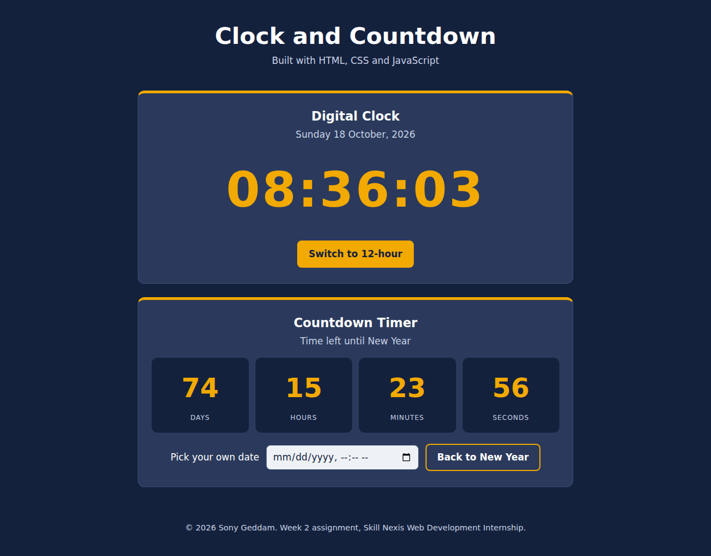

# Digital Clock and Countdown Timer

Week 2 assignment (CSS and Basic JavaScript) of the Skill Nexis Web Development Internship.

**Live demo:** https://sony539.github.io/week2-clock/

## Features

- Live digital clock in HH:MM:SS, updating every second
- Today's date shown under the clock
- 24-hour and 12-hour (AM/PM) toggle
- Countdown timer to the next New Year (days, hours, minutes, seconds)
- Optional: pick any date and time to count down to
- Responsive layout that works on desktop and mobile

## Concepts practised

- JavaScript `Date()` object
- `setInterval()` to run code every second
- DOM manipulation (`getElementById`, `textContent`)
- Event handling (`click`, `change`)
- CSS Grid, Flexbox and CSS variables

## Project structure

```
week2-clock/
├── index.html
├── style.css
├── script.js
├── README.md
└── screenshot.png
```

## How to run

Open `index.html` in any browser. No installation needed.

## Screenshot



## Author

Sony Geddam
- GitHub: [sony539](https://github.com/sony539)
- LinkedIn: [sony-geddam-b898723a3](https://www.linkedin.com/in/sony-geddam-b898723a3)
